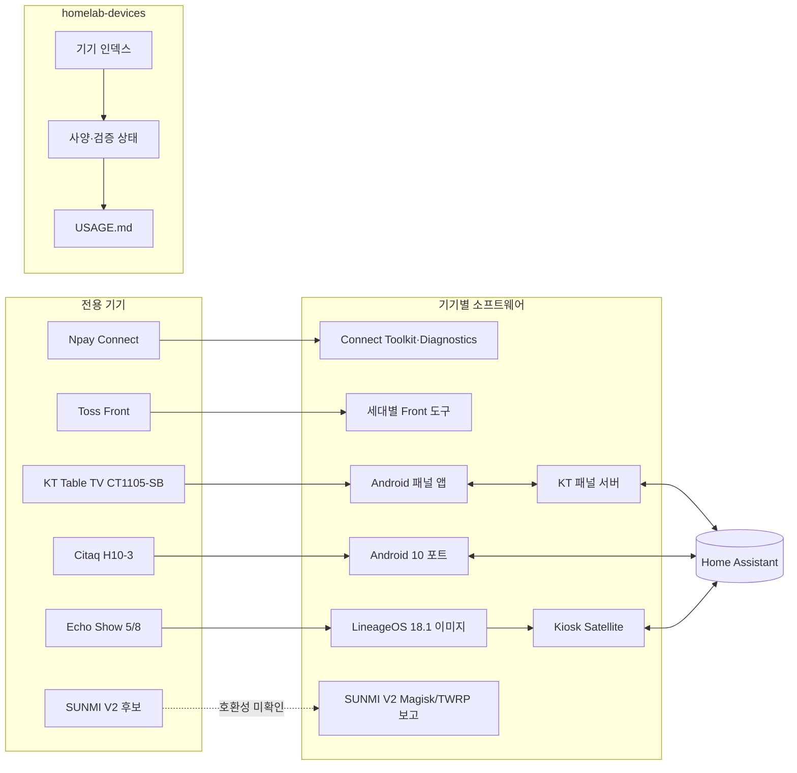

# homelab-devices

결제 단말기와 매장용 패널, 스마트 디스플레이처럼 전용 목적으로 판매된 기기를 홈랩에서 재활용하는 사례와 도구를 모읍니다.

**조사 갱신일: 2026-11-28** · 비공개 저장소 · 원본 코드를 포크하거나 복사하지 않고 기기별 사양, 호환 범위, 프로젝트와 사용 문서를 연결합니다.

## 아키텍처

Npay Connect와 Toss Front 문서는 기기 리서치와 복구 도구를 찾는 입구입니다. KT Table TV, Citaq H10-3, Echo Show는 Android 패널과 Home Assistant 연동 사례가 있습니다. 각 기능의 실제 기기 검증 범위는 기기 문서에서 구분합니다.

## 기기별 핵심 사양

| 기기 | 식별 정보 | 핵심 사양 | 상태·상세 |
|---|---|---|---|
| Npay Connect | Npay connect 1 / Face 1 | Android 15, 8인치 1280×800, 2×A75 + 6×A55, RAM 4GB, eMMC 32GB | 공개 툴 있음 · [문서](devices/naver-connect.md) |
| Toss Front | 1세대 PLF00WH, 1.5세대 PLF02WH, 2세대 | 1.5세대 RK3399, 2세대 QCM4325; 1세대 칩셋 미상 | 세대별 도구 차이 · [문서](devices/toss-front.md) |
| KT 기가지니 테이블 TV 더 블랙 | CT1105-SB | Hi3798CV200, 4×Cortex-A53, RAM 2GB, eMMC 8GB, 11.6인치 1920×1080 | HA 패널 프로젝트 · [문서](devices/kt-table-tv.md) |
| Citaq H10-3 POS | CTE-RK3368-V1.0 | RK3368, 8×Cortex-A53, PowerVR G6110, RAM 2GB, eMMC 16GB, 10인치 1024×768, 80mm 프린터 | Android 10 포트와 HA 연동 · [문서](devices/citaq-h10-3.md) |
| Amazon Echo Show 8 2세대 | A8H3N2 / `athena` | MT8183, 8인치 1280×800 HD, 13MP 카메라, 듀얼 스테레오 스피커, 듀얼밴드 Wi-Fi·Bluetooth | LineageOS/HA 이미지 · [문서](devices/amazon-echo-show.md) |
| SUNMI V2 | T5930; 세대·구성 확인 필요 | Android 7.1, Cortex-A53 1.3/1.5GHz, RAM 1/2GB, 저장공간 8/16GB, 5.45인치 1440×720, 58mm 프린터 | 루팅 보고는 있으나 호환성 불확실 · [후보 문서](devices/sunmi-v2.md) |
| CashNote Pay 단말기 | 정확한 모델 미공개 | Android 10 기반 AVOS, 5.5인치, RAM 2GB, 플래시 16GB, Cortex-A53 쿼드코어 | 사양만 확인; 공개 재활용 툴 미발견 · [후보 문서](devices/cashnote-pay.md) |
| 티오더 주문 태블릿 | `T2N`, `torder pad` 계열 | T2N FCC 문서 기준 UNISOC T610, RAM 4GB, 저장공간 32GB, 10.1인치 1920×1200 | 모델별 사양 조사 · [후보 문서](devices/torder.md) |

## 별도 사용 안내

기기 고르기, 모델 식별, 적합한 원본 가이드 선택, Home Assistant에 연결하는 흐름은 [USAGE.md](USAGE.md)에 따로 정리했습니다. 이 저장소는 프로젝트를 복제하지 않고, 각 기기의 원본 설치·복구 가이드로 연결합니다.

## 조사 기준

- 제조사·인증기관 공개 사양, 프로젝트 문서, 커뮤니티 실기기 보고를 구분합니다.
- 작성자 보고를 별도 재현한 결과처럼 쓰지 않습니다. 미확인 모델은 지원된다고 추정하지 않습니다.
- 펌웨어·APK·기기 덤프와 도구 코드를 이 저장소에 복사하지 않습니다.
- 커스텀 ROM이나 루트 도구가 있다고 해서 결제·서비스 기능까지 동작한다고 보지 않습니다.
- 주력 가맹점 장비가 아닌, 본인 소유의 실험 기기를 기준으로 연구합니다.

## 연구 후보

Amazon Echo Show 15의 런타임 루트 프로젝트도 찾았지만 개발자 프리뷰이며 한 대에서만 확인됐고, 커널 패닉 위험을 안내합니다. 이를 검증된 설치 경로로 분류하지 않았습니다. 자세한 범위는 [Echo Show 문서](devices/amazon-echo-show.md)를 참조하세요.
